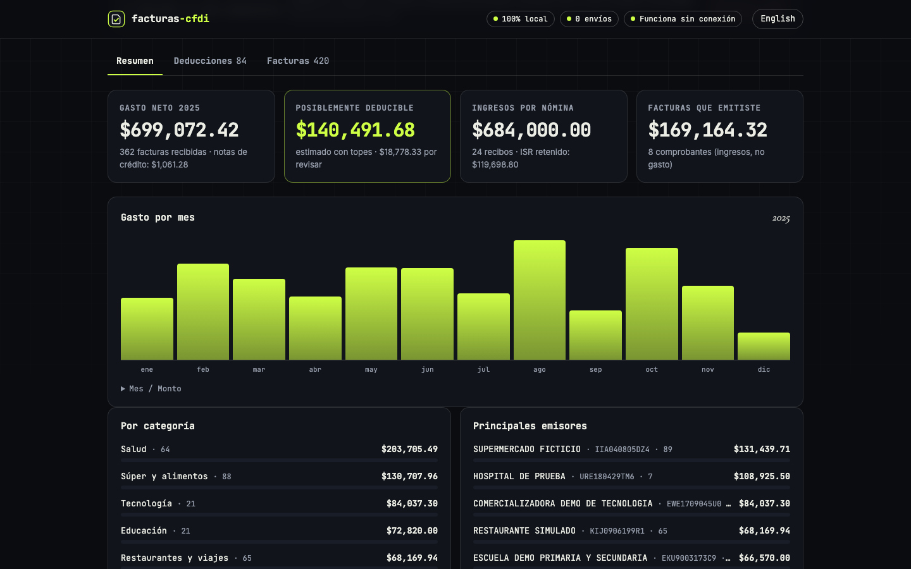
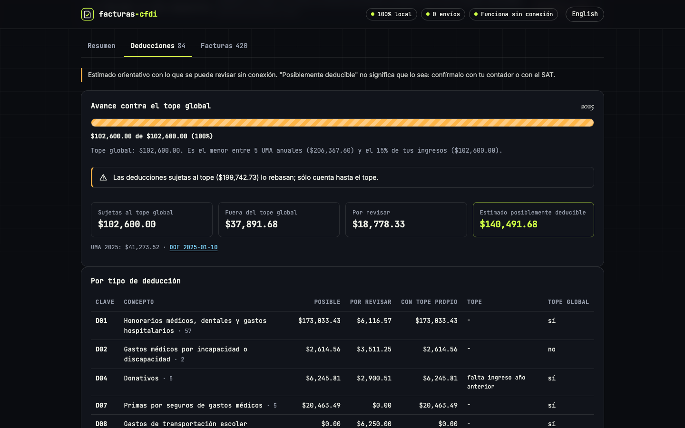
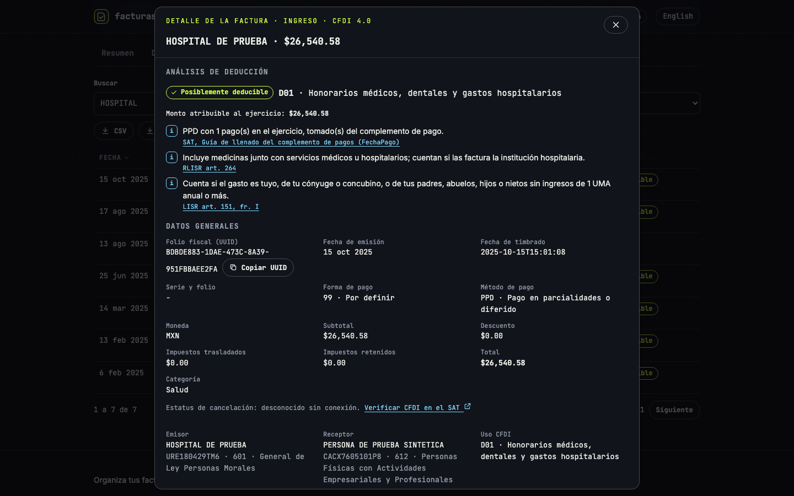
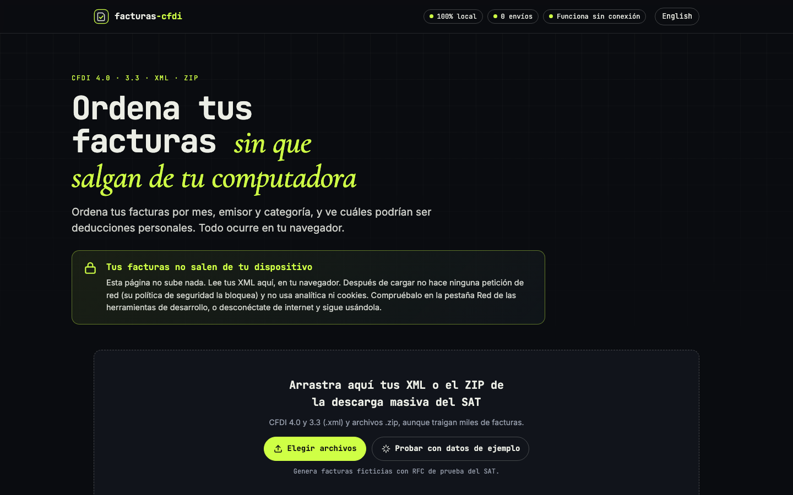
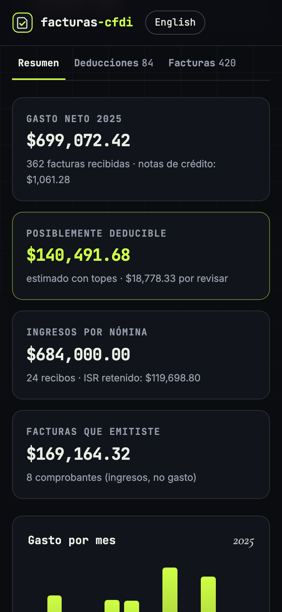
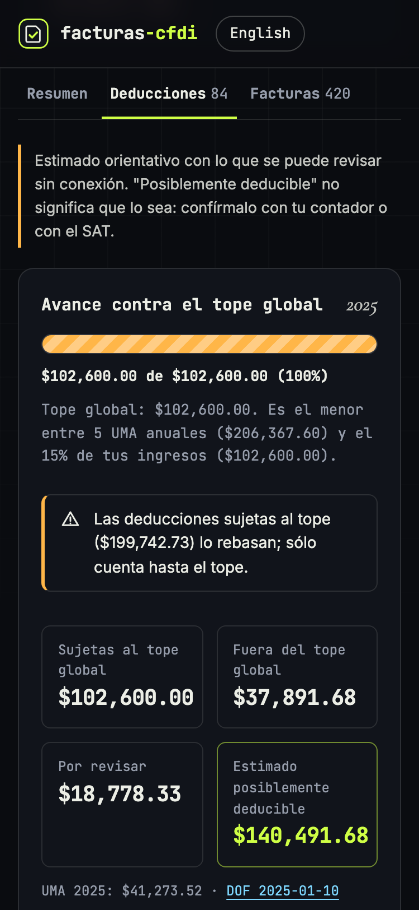
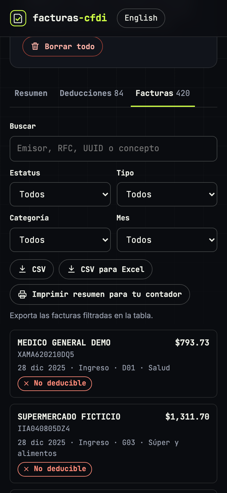
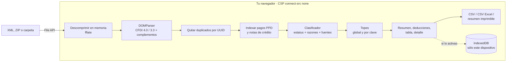

<p align="center">
  
</p>

<p align="center">
  <a href="https://beg-lag.github.io/facturas-cfdi/"><strong>Abrir la app</strong></a> ·
  <a href="README.md">Read in English</a> ·
  <a href="docs/reglas.md">Reglas y fuentes oficiales</a>
</p>

<p align="center">
  <a href="https://github.com/BEG-lag/facturas-cfdi/actions/workflows/ci.yml"></a>
  <a href="https://github.com/BEG-lag/facturas-cfdi/actions/workflows/deploy.yml"></a>
  <a href="LICENSE"></a>
</p>

# facturas-cfdi

Una app web privada por diseño para personas en México. Arrastra tus XML de facturas CFDI, o el ZIP
de la descarga masiva del SAT, y **todo en tu navegador, sin subir nada**, ordena tu gasto por mes,
emisor y categoría y señala qué facturas podrían contar como **deducciones personales** en tu
declaración anual, con las razones por las que algunas no califican.

> **Aviso.** Organiza tus facturas; no es asesoría fiscal y no sustituye a tu contador ni al SAT.

## Qué hace

- Lee **CFDI 4.0 y 3.3**: Comprobante, Emisor, Receptor, Conceptos, Impuestos y el UUID del Timbre
  Fiscal Digital, además de los complementos que encuentre (Pagos 1.0 y 2.0, Nómina 1.2, Impuestos
  locales, Leyendas fiscales, Instituciones educativas privadas, Donatarias). Busca los nodos por
  nombre local, así que tolera prefijos raros o un namespace por omisión.
- Acepta `.xml` sueltos, `.zip` (también ZIP dentro de ZIP) y carpetas completas arrastradas.
- Trata bien cada tipo: los **I** son gasto, los **E** (notas de crédito) restan a la factura que
  corrigen, los **P** (complementos de pago) dicen cuándo se pagó una factura PPD, la **N** (nómina)
  se muestra aparte como ingreso y los **T** (traslado) sólo se cuentan.
- Quita **duplicados por UUID**.
- **Resumen**: gasto neto, gasto por mes, por categoría y principales emisores, ingresos por nómina e
  ISR retenido, facturas que emitiste.
- **Deducciones**: cada factura queda como *posiblemente deducible*, *requiere revisión (razón)* o
  *no deducible (razón)*, con avance contra el tope global y los topes propios de cada clave. Nunca
  afirma que una factura **es** deducible.
- **Tabla** con búsqueda, filtros, orden y paginación; **detalle** de cada factura con cada razón
  ligada a su fuente legal; exportación a **CSV** y **CSV para Excel**; **resumen imprimible** para tu
  contador.
- Interfaz en español con opción en inglés. Funciona sin conexión (PWA). Pensada para celular.

## Privacidad

Tus facturas no salen de tu dispositivo, y eso se impone, no sólo se promete:

- **Sin subidas ni servidor.** Los archivos se leen con la File API, se descomprimen con
  [fflate](https://github.com/101arrowz/fflate) y se leen con el `DOMParser` del navegador.
- **Una política de seguridad de contenido (CSP) bloquea la red.** La página publicada incluye
  `connect-src 'none'`: el navegador rechaza `fetch`, XHR, WebSocket y beacons. Scripts, estilos y
  fuentes sólo pueden venir del mismo origen.
- **Sin analítica, sin cookies, sin CDN de terceros.** Las tipografías (JetBrains Mono, Inter,
  Cormorant Garamond) van incluidas y se cargan todas al inicio; después no hay ni una petición de
  fuentes.
- **Verificado en CI.** Una prueba de Playwright carga en el build de producción un ZIP sintético con
  2,500 XML más 30 XML sueltos, recorre todas las vistas, abre una factura y exporta un CSV, y
  comprueba que **no hubo ninguna petición HTTP** después de que la página quedó lista (incluidas las
  del service worker). Otra prueba demuestra que la CSP bloquea `fetch`.
- **Nada se guarda por omisión.** Si lo activas ("Recordar en este dispositivo"), las facturas
  procesadas se guardan sólo en el IndexedDB de este navegador hasta que pulses **Borrar todo**, que
  elimina la base.
- **El estatus de cancelación no se puede revisar sin conexión.** La app lo dice y enlaza al
  [servicio oficial de verificación de CFDI del SAT](https://verificacfdi.facturaelectronica.sat.gob.mx/);
  nunca consulta al SAT desde tu navegador.

## Capturas

Todas las capturas usan datos sintéticos generados con RFC de prueba del SAT.

| Resumen | Deducciones |
|---|---|
|  |  |

| Detalle de factura | Inicio |
|---|---|
|  |  |

<p align="center">
  
  
  
</p>

## Cómo funciona



El parseo corre en el hilo principal en lotes pequeños que ceden el control al navegador (DOMParser
no existe dentro de Web Workers), así que la página no se congela. En pruebas locales, Chromium
procesó un ZIP con 2,525 XML (2,500 únicos más duplicados) en **unos 0.13 s**; la prueba unitaria
parsea y analiza el mismo volumen en jsdom en unos 0.3 s.

## Reglas de deducción en corto

| Clave | Qué es | Qué se revisa sin conexión |
|---|---|---|
| D01 | Honorarios médicos, dentales, de psicología y nutrición, gastos hospitalarios | RFC receptor, año de pago, **pago no en efectivo** (LISR 151-I), medicinas sólo en factura de hospital, tope de lentes |
| D02 | Gastos médicos por incapacidad o discapacidad | La factura debe decir que se relaciona con la discapacidad; fuera del tope global |
| D03 | Gastos funerales | Tope propio de 1 UMA anual |
| D04 | Donativos | Complemento de donatarias o revisar el directorio; 7% del ingreso del año anterior |
| D05 | Intereses reales hipotecarios | Siempre "requiere revisión": usa la constancia anual del banco |
| D06 | Aportaciones voluntarias para el retiro | 10% de ingresos hasta 5 UMA; fuera del tope global |
| D07 | Primas de seguros de gastos médicos | Recordatorio de beneficiarios |
| D08 | Transporte escolar obligatorio | Siempre "requiere revisión"; **pago no en efectivo** (LISR 151-VII) |
| D09 | Cuentas especiales para el ahorro (LISR 185) | Tope de $152,000; fuera del tope global |
| D10 | Colegiaturas | Complemento iedu, topes por alumno y nivel, sin inscripción, **pago no en efectivo** (Decreto art. 1.9); fuera del tope global |

El **tope global** es el menor entre 5 UMA anuales y el 15% de tus ingresos totales (LISR art. 151,
último párrafo). Tus ingresos son un dato opcional; sin ellos sólo se aplica el tope de 5 UMA y la app
lo avisa. Cada regla, con citas textuales, enlaces y fecha de consulta, está en
**[docs/reglas.md](docs/reglas.md)**.

### Valores de UMA

Valores oficiales del INEGI publicados en el DOF, vigentes desde el 1 de febrero de cada año; puedes
cambiarlos en la app.

| Año | UMA anual | 5 UMA | Fuente |
|---|---|---|---|
| 2023 | $37,844.40 | $189,222.00 | [DOF 10-01-2023](https://dof.gob.mx/nota_detalle.php?codigo=5676670&fecha=10/01/2023) |
| 2024 | $39,606.36 | $198,031.80 | [DOF 10-01-2024](https://dof.gob.mx/nota_detalle.php?codigo=5714085&fecha=10/01/2024) |
| 2025 | $41,273.52 | $206,367.60 | [DOF 10-01-2025](https://dof.gob.mx/nota_detalle.php?codigo=5746930&fecha=10/01/2025) |
| 2026 | $42,794.64 | $213,973.20 | [DOF 09-01-2026](https://dof.gob.mx/nota_detalle.php?codigo=5778072&fecha=09/01/2026) |

Para un ejercicio la app usa la UMA de ese mismo año, lo que coincide con la cifra que publica el SAT
para 2025 en sus preguntas frecuentes de la declaración anual. Esa correspondencia es inferencia
nuestra; ver [docs/reglas.md](docs/reglas.md#8-valor-de-la-uma).

### Fuentes oficiales principales

- [Ley del Impuesto sobre la Renta](https://www.diputados.gob.mx/LeyesBiblio/pdf/LISR.pdf), arts. 151, 152 y 185
- [Reglamento de la LISR](https://www.diputados.gob.mx/LeyesBiblio/regley/Reg_LISR_060516.pdf), arts. 264 y 266 a 269
- [Decreto de colegiaturas, DOF 26-12-2013](https://dof.gob.mx/nota_detalle.php?codigo=5328028&fecha=26/12/2013), arts. 1.8 a 1.10
- [Anexo 20 y catálogos CFDI del SAT](http://omawww.sat.gob.mx/tramitesyservicios/Paginas/anexo_20.htm) (c_UsoCFDI, c_FormaPago, c_RegimenFiscal)
- [Preguntas frecuentes de la Declaración Anual 2025, personas físicas](https://www.sat.gob.mx/minisitio/DeclaracionAnual/Personas/documentos/PreguntasFrecuentes_AnualPF2025.pdf)

## Limitaciones

- **No es asesoría fiscal.** "Posiblemente deducible" quiere decir que pasó las revisiones sin
  conexión, no que el SAT la vaya a aceptar.
- No puede saber si una factura fue **cancelada**, si un beneficiario califica, si el prestador tiene
  título, si el RVOE de la escuela es válido, si hubo becas, si existe el certificado de discapacidad,
  si la donataria está autorizada ni si el transporte escolar es obligatorio.
- Las facturas PPD necesitan su complemento de pago cargado para saber cuándo se pagaron.
- El tope de 4% para donativos a gobiernos, el de $2,500 por persona en lentes y el límite de ingresos
  de 1 UMA de los beneficiarios se señalan, pero no se pueden calcular con el XML.
- Las categorías de gasto son una heurística basada en la clave de producto o servicio
  (c_ClaveProdServ), no una clasificación del SAT.
- No calcula el impuesto anual, no lee CFDI 3.2 ni analiza CFDI de retenciones.
- Algunos puntos legales no se pudieron verificar y así se marcan en
  [docs/reglas.md](docs/reglas.md#12-pendientes-no-verificados).

## Úsala en tu computadora

Requiere Node.js 22.18 o posterior (los scripts usan el soporte nativo de TypeScript de Node).

```bash
npm install
npm run dev          # http://localhost:5173/facturas-cfdi/
npm run check        # typecheck + lint + pruebas unitarias + build
npx playwright install chromium
npm run e2e          # construye, sirve y corre las pruebas de punta a punta
npm run screenshots  # regenera docs/screenshots con datos sintéticos
```

Pulsa **Probar con datos de ejemplo** para generar unas 400 facturas ficticias en tu navegador.

### Pruebas

- **79 pruebas de Vitest** para el parser (4.0, 3.3, namespaces, complementos, errores), el clasificador (cada clave
  y requisito), los topes, la agregación, los ZIP, el CSV y las traducciones.
- **13 pruebas de Playwright** sobre el build de producción: cero peticiones de red al cargar más de 2,500 archivos,
  la CSP bloquea `fetch`, modo sin conexión, guardado opcional y borrado, exportaciones, resumen
  imprimible, navegación con teclado, revisión axe WCAG 2.1 A/AA y sin desplazamiento horizontal a
  375 px.
- Los datos de prueba son **sólo sintéticos**: RFC de prueba del SAT (por ejemplo EKU9003173C9,
  CACX7605101P8), los RFC genéricos XAXX010101000 y XEXX010101000 y nombres inventados. Ver
  [`src/lib/synthetic.ts`](src/lib/synthetic.ts).

## Autor

**Benjamín Esponda García**, abogado en la Ciudad de México que construye con IA.

- Sitio: [pivotek.mx](https://pivotek.mx)
- Portafolio: [github.com/BEG-lag/portafolio-ia](https://github.com/BEG-lag/portafolio-ia)

## Licencia

[MIT](LICENSE). Las tipografías se incluyen desde Fontsource bajo la SIL Open Font License.
