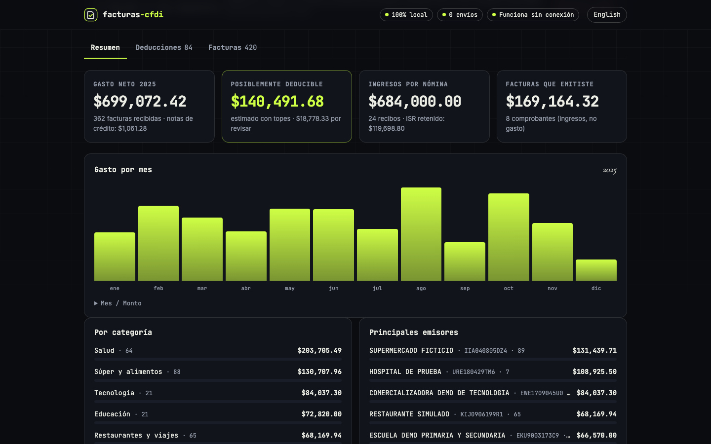
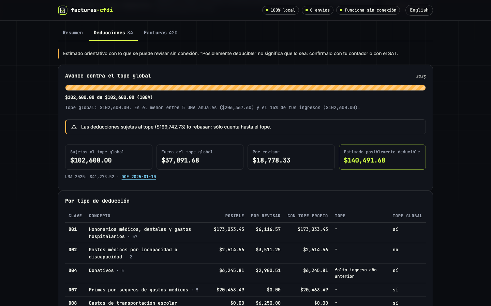
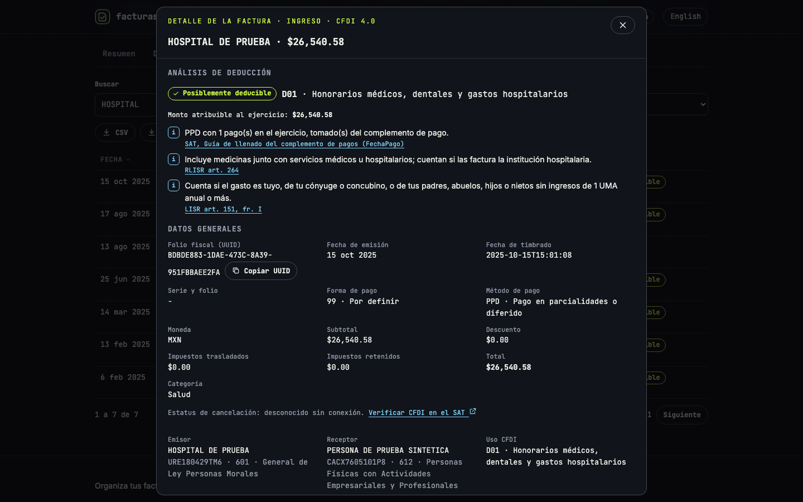
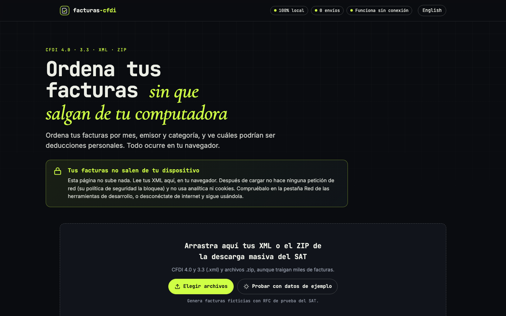
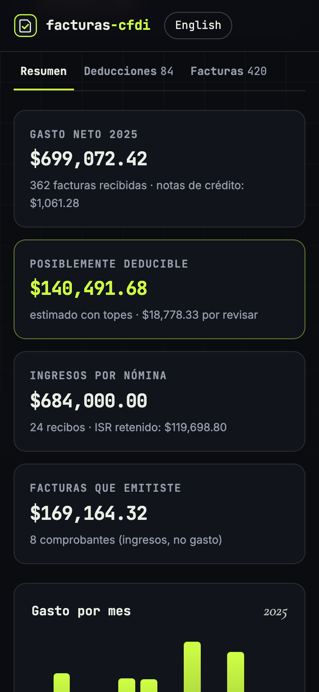
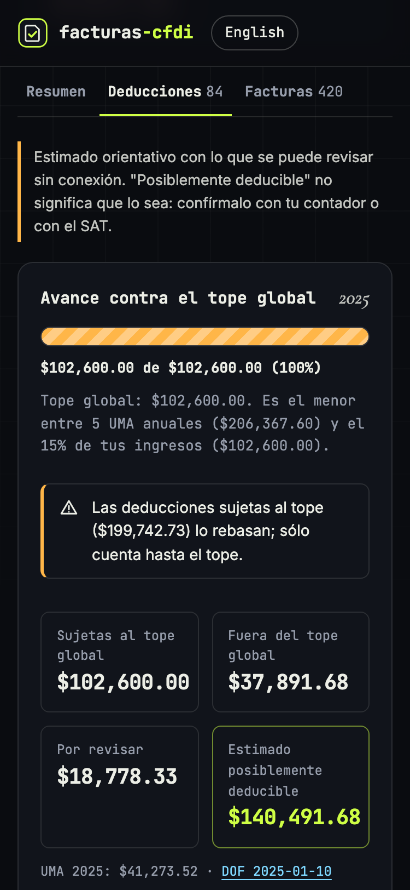
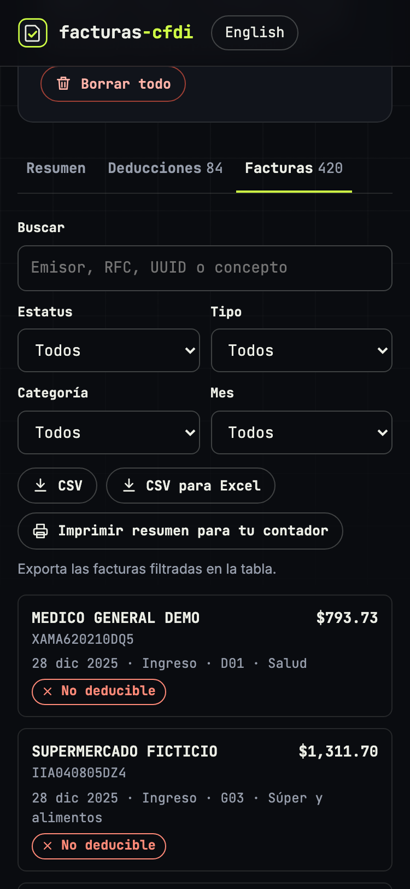
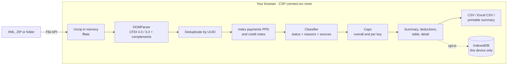

<p align="center">
  
</p>

<p align="center">
  <a href="https://beg-lag.github.io/facturas-cfdi/"><strong>Open the app</strong></a> ·
  <a href="README.es.md">Leer en español</a> ·
  <a href="docs/reglas.md">Rules and official sources</a>
</p>

<p align="center">
  <a href="https://github.com/BEG-lag/facturas-cfdi/actions/workflows/ci.yml"></a>
  <a href="https://github.com/BEG-lag/facturas-cfdi/actions/workflows/deploy.yml"></a>
  <a href="LICENSE"></a>
</p>

# facturas-cfdi

A private-by-design web app for people in Mexico. Drop your CFDI invoice XML files, or the ZIP that
the SAT bulk download ("descarga masiva") gives you, and **entirely in your browser, with nothing
uploaded**, it organizes your spending by month, issuer and category and flags which invoices could
count as **personal deductions** (deducciones personales) for your annual tax return, with the
reasons some do not qualify.

> **Disclaimer.** Organizes your invoices; it is not tax advice and does not replace your accountant
> or the SAT.

## What it does

- Reads **CFDI 4.0 and 3.3**: Comprobante, Emisor, Receptor, Conceptos, Impuestos and the Timbre
  Fiscal Digital UUID, plus the complements it meets (Pagos 1.0 and 2.0, Nómina 1.2, Impuestos
  locales, Leyendas fiscales, Instituciones educativas privadas, Donatarias). Namespaces are handled
  by local name, so odd prefixes or a default namespace still parse.
- Accepts loose `.xml` files, `.zip` files (nested ZIPs too) and whole folders dragged in.
- Treats each document type correctly: **I** invoices are spending, **E** credit notes subtract from
  the invoice they correct, **P** payment complements prove when a deferred (PPD) invoice was paid,
  **N** payroll is shown separately as income, **T** transfers are only counted.
- Removes **duplicates by UUID**.
- **Summary**: net spending, spending by month, by category and top issuers, payroll income and ISR
  withheld, invoices you issued.
- **Deductions**: each invoice is labeled *posiblemente deducible* (possibly deductible), *requiere
  revisión* (needs review, with the reason) or *no deducible* (not deductible, with the reason), with
  progress against the overall cap and per-type caps. It never claims an invoice **is** deductible.
- **Table** with search, filters, sort and pagination; **invoice detail** with every reason linked to
  its legal source; **CSV** and **Excel-friendly CSV** export; a **printable summary** for your
  accountant.
- Spanish interface with an English toggle. Works offline (PWA). Mobile friendly.

## Privacy

Your invoices never leave your device, and this is enforced, not just promised:

- **No uploads, no backend.** Files are read with the File API, unzipped with
  [fflate](https://github.com/101arrowz/fflate) and parsed with the browser's `DOMParser`.
- **A Content Security Policy blocks the network.** The production page ships
  `connect-src 'none'`, so `fetch`, XHR, WebSocket and beacons are refused by the browser. Scripts,
  styles and fonts may only come from the same origin.
- **No analytics, no cookies, no third-party CDNs.** Fonts (JetBrains Mono, Inter, Cormorant
  Garamond) are self-hosted and all loaded at startup, so not even a font request happens later.
- **Verified in CI.** A Playwright test loads a synthetic ZIP with 2,500 XML files plus 30 loose
  files into the production build, clicks through every view, opens an invoice and exports a CSV, and
  asserts that **zero HTTP requests** were made after the page was ready (including service worker
  requests). Another test proves that `fetch` is blocked by the CSP.
- **Nothing is stored by default.** If you opt in ("Recordar en este dispositivo"), processed
  invoices are kept only in this browser's IndexedDB until you press **Borrar todo** (delete
  everything), which deletes the database.
- **Cancellation status cannot be checked offline.** The app says so and links to the official
  [SAT CFDI verification service](https://verificacfdi.facturaelectronica.sat.gob.mx/); it never calls
  the SAT from your browser.

## Screenshots

All screenshots use synthetic data generated with SAT test RFCs.

| Summary | Deductions |
|---|---|
|  |  |

| Invoice detail | Landing |
|---|---|
|  |  |

<p align="center">
  
  
  
</p>

## How it works



Parsing runs on the main thread in small batches that yield to the browser (DOMParser is not
available inside Web Workers), so the page stays responsive. In local runs, Chromium processed a ZIP
with 2,525 XML files (2,500 unique plus duplicates) in **about 0.13 s**; the unit test parses and
analyzes the same volume under jsdom in about 0.35 s.

## Deduction rules in short

| Key | What it is | Checked offline |
|---|---|---|
| D01 | Medical, dental, psychology and nutrition fees, hospital expenses | Receiver RFC, year paid, **non-cash payment** (LISR 151-I), medicines only on hospital bills, lenses cap |
| D02 | Medical expenses for incapacity or disability | Invoice must say it relates to the disability; outside the overall cap |
| D03 | Funeral expenses | Own cap of 1 annual UMA |
| D04 | Donations | Donee complement or directory check; 7% of previous-year income |
| D05 | Real mortgage interest | Always "needs review": use the bank's annual statement |
| D06 | Voluntary retirement contributions | 10% of income up to 5 UMA; outside the overall cap |
| D07 | Health insurance premiums | Beneficiary reminder |
| D08 | Mandatory school transport | Always "needs review"; **non-cash payment** (LISR 151-VII) |
| D09 | Special savings accounts (LISR 185) | Cap of $152,000; outside the overall cap |
| D10 | School tuition (colegiaturas) | iedu complement, per-student caps by level, enrollment fees excluded, **non-cash payment** (Decree art. 1.9); outside the overall cap |

The **overall cap** is the lesser of 5 annual UMAs or 15% of your total income (LISR art. 151, last
paragraph). Income is an optional input; without it only the 5 UMA cap is applied, and the app says
so. Every rule, with verbatim quotes, links and the date consulted, is in
**[docs/reglas.md](docs/reglas.md)** (in Spanish).

### UMA values used

Official INEGI values published in the DOF, in force from February 1 of each year; overridable in the
app.

| Year | Annual UMA | 5 UMAs | Source |
|---|---|---|---|
| 2023 | $37,844.40 | $189,222.00 | [DOF 10-01-2023](https://dof.gob.mx/nota_detalle.php?codigo=5676670&fecha=10/01/2023) |
| 2024 | $39,606.36 | $198,031.80 | [DOF 10-01-2024](https://dof.gob.mx/nota_detalle.php?codigo=5714085&fecha=10/01/2024) |
| 2025 | $41,273.52 | $206,367.60 | [DOF 10-01-2025](https://dof.gob.mx/nota_detalle.php?codigo=5746930&fecha=10/01/2025) |
| 2026 | $42,794.64 | $213,973.20 | [DOF 09-01-2026](https://dof.gob.mx/nota_detalle.php?codigo=5778072&fecha=09/01/2026) |

For a tax year the app uses that year's UMA, which matches the SAT's own figure for 2025 in its annual
return FAQ. That mapping is our inference; see [docs/reglas.md](docs/reglas.md#8-valor-de-la-uma).

### Main official sources

- [Ley del Impuesto sobre la Renta](https://www.diputados.gob.mx/LeyesBiblio/pdf/LISR.pdf), arts. 151, 152 and 185
- [Reglamento de la LISR](https://www.diputados.gob.mx/LeyesBiblio/regley/Reg_LISR_060516.pdf), arts. 264 and 266 to 269
- [Colegiaturas decree, DOF 26-12-2013](https://dof.gob.mx/nota_detalle.php?codigo=5328028&fecha=26/12/2013), arts. 1.8 to 1.10
- [SAT Anexo 20 and CFDI catalogs](http://omawww.sat.gob.mx/tramitesyservicios/Paginas/anexo_20.htm) (c_UsoCFDI, c_FormaPago, c_RegimenFiscal)
- [SAT FAQ, 2025 annual return for individuals](https://www.sat.gob.mx/minisitio/DeclaracionAnual/Personas/documentos/PreguntasFrecuentes_AnualPF2025.pdf)

## Limitations

- **Not tax advice.** "Possibly deductible" means the offline checks passed, not that the SAT will
  accept it.
- Cannot know whether an invoice was **cancelled**, whether a beneficiary qualifies, whether the
  provider has a professional license, whether a school's RVOE is valid, scholarships, disability
  certificates, whether a donee is authorized, or whether school transport is mandatory.
- Deferred invoices (PPD) need their payment complement loaded to know when they were paid.
- The 4% cap for donations to governments, the $2,500 lenses cap per person and the 1 UMA income
  limit of beneficiaries are flagged but cannot be computed from the XML.
- Spending categories are a heuristic based on the product/service code (c_ClaveProdServ), not a SAT
  classification.
- Does not compute the annual tax, read CFDI 3.2, or analyze withholding CFDIs (Retenciones).
- Some legal points could not be verified and are marked as such in
  [docs/reglas.md](docs/reglas.md#12-pendientes-no-verificados).

## Run it locally

Requires Node.js 22.18 or newer (the scripts use Node's built-in TypeScript support).

```bash
npm install
npm run dev          # http://localhost:5173/facturas-cfdi/
npm run check        # typecheck + lint + unit tests + build
npx playwright install chromium
npm run e2e          # builds, serves and runs the end-to-end tests
npm run screenshots  # regenerates docs/screenshots with synthetic data
```

Click **Probar con datos de ejemplo** (try with sample data) to generate about 400 fictitious
invoices in your browser.

### Tests

- **Vitest** unit tests for the parser (4.0, 3.3, namespaces, complements, errors), the classifier
  (every key and requirement), the caps, aggregation, ZIP handling, CSV and i18n.
- **Playwright** end-to-end tests on the production build: zero network requests while loading 2,500+
  files, CSP blocks `fetch`, offline mode, opt-in storage and delete, exports, printable summary,
  keyboard navigation, axe WCAG 2.1 A/AA checks and no horizontal scroll at 375 px.
- Test data is **synthetic only**: SAT test RFCs (for example EKU9003173C9, CACX7605101P8), the generic
  RFCs XAXX010101000 and XEXX010101000, and invented names. See
  [`src/lib/synthetic.ts`](src/lib/synthetic.ts).

### Project structure

```
src/lib/      parser, catalogs, rules and UMA, classifier, caps, aggregation, ingest, CSV, i18n, storage
src/ui/       views, app state and events, printable summary, icons
plugins/      Vite plugins: CSP injection and a dependency-free service worker
tests/        unit tests, end-to-end tests and hand-written fixtures
docs/         rules and official sources (Spanish), screenshots
```

## Author

**Benjamín Esponda García**, a lawyer in Mexico City who builds with AI.

- Site: [pivotek.mx](https://pivotek.mx)
- Portfolio: [github.com/BEG-lag/portafolio-ia](https://github.com/BEG-lag/portafolio-ia)

## License

[MIT](LICENSE). Fonts are bundled from Fontsource under the SIL Open Font License.
